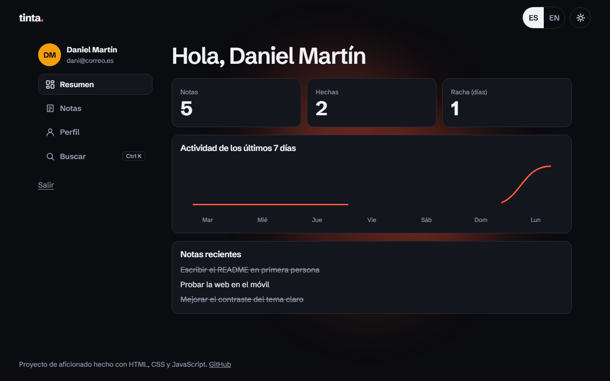
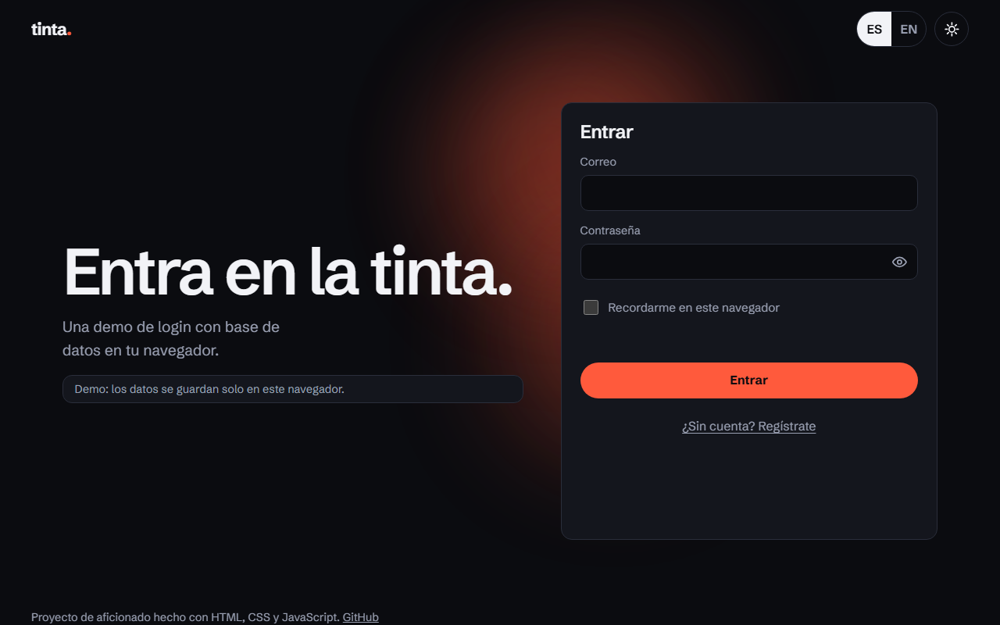

# Tinta · login animado

Una pantalla de acceso (entrar y crear cuenta) con un mini panel detrás, hecha solo con HTML, CSS y JavaScript. Las cuentas y las notas se guardan en una base de datos del propio navegador (IndexedDB), sin servidor. Está en español y en inglés, con tema oscuro y claro, y el cambio de tema es una mancha de tinta que se extiende desde el botón.

**Demo:** https://danimartin03.github.io/login-animado





## Qué hace

- **Registro e inicio de sesión** con una tarjeta que gira en 3D entre un formulario y otro.
- **Contraseñas guardadas con hash** (PBKDF2-SHA256, 600.000 iteraciones y sal aleatoria por contraseña) con la API `crypto.subtle`. Nunca se guarda la contraseña en claro.
- **Bloqueo temporal** tras 5 intentos fallidos (30 s), también para correos que no existen.
- **Sesión** con un token aleatorio del que solo se guarda el hash. Dura 12 h, o 7 días si marco "recordarme".
- **Tema oscuro y claro** con la transición de la mancha de tinta (View Transitions API), que sale del botón y vuelve a él.
- **Español e inglés** con las letras del texto cambiando una a una.
- **Medidor de contraseña** en forma de tubo que se llena, sacudida del formulario si hay error y confeti al crear la cuenta.
- **Fondo vivo** con manchas de color que siguen al puntero.
- **Panel** con resumen (números que cuentan, gráfica de actividad de 7 días y racha), notas (crear, marcar, filtrar, borrar con "Deshacer"), perfil (nombre, color del avatar, cambiar contraseña y eliminar la cuenta) y buscador de acciones con `Ctrl K`.

## Lo que he aprendido

<!-- TODO: repasar esta lista y dejarla con mis palabras -->
- A guardar datos en IndexedDB y a cargarlos con promesas, con un plan B en memoria si el navegador no la deja usar.
- Cómo se guarda bien una contraseña: hash lento con sal, comparación sin atajos y por qué nunca se guarda en claro.
- A usar la View Transitions API para animar el cambio de tema con un `clip-path` que calculo en cada fotograma.
- A hacer un giro 3D con `backface-visibility` sin que se pueda tabular al formulario que no se ve (`inert`).
- A probar casos raros: nombres larguísimos, emojis, 200 notas, texto al 200 %, y a probar con teclado y en 320 px.

## Tecnologías

- HTML, CSS y JavaScript sin frameworks ni herramientas de compilación.
- IndexedDB, `crypto.subtle`, View Transitions API, `Intl.Segmenter`.
- Fuente [Schibsted Grotesk](https://fonts.google.com/specimen/Schibsted+Grotesk) (licencia SIL OFL), incluida en `fonts/`.

## Cómo ejecutarlo en local

No hace falta instalar nada. Algunas funciones (IndexedDB, `crypto.subtle`) van mejor desde `http://localhost` que abriendo el archivo directamente, así que lo sirvo con un servidor sencillo:

```bash
python -m http.server 5580
```

y abro http://localhost:5580.

## Estructura

```
index.html        Estructura de las dos vistas (acceso y panel) y el buscador
css/estilos.css   Temas, giro 3D, formularios, panel y animaciones
fonts/            Tipografía
js/textos.js      Diccionario ES/EN
js/idioma.js      Cambio de idioma con el efecto de letras
js/cripto.js      Hash de contraseñas y utilidades de crypto
js/bd.js          Capa sobre IndexedDB (con plan B en memoria)
js/usuarios.js    Cuentas, sesiones, bloqueo, notas y validaciones
js/tema.js        Tema claro/oscuro y la mancha de tinta
js/fondo.js       Fondo animado
js/acceso.js      Tarjeta que gira, errores, vial, sacudida y confeti
js/panel.js       Resumen, notas, perfil
js/paleta.js      Buscador de acciones (Ctrl K)
js/app.js         Arranque y control de la sesión
```

## Límites

- **Es una demo.** Todo vive en el navegador de quien la abre: no hay servidor, así que no es seguridad real. Cualquiera con acceso a ese navegador puede ver o borrar los datos desde las herramientas de desarrollo. Nada se envía a ningún sitio.
- Si borro los datos del sitio, desaparecen las cuentas y las notas.
- La transición de tinta necesita un navegador con View Transitions; en los demás se cambia de tema con un fundido.
- No lo he probado en Safari, Firefox ni en un móvil real, solo en Edge (escritorio y emulando móvil).
- Con idiomas de derecha a izquierda no se refleja el diseño (algunos márgenes son físicos).

## Posibles mejoras

- Enlaces directos a cada sección del panel.
- Reflejar el diseño en idiomas de derecha a izquierda.
- Más idiomas.
- Exportar e importar las notas.

## Licencia

MIT, ver [LICENSE](LICENSE).
